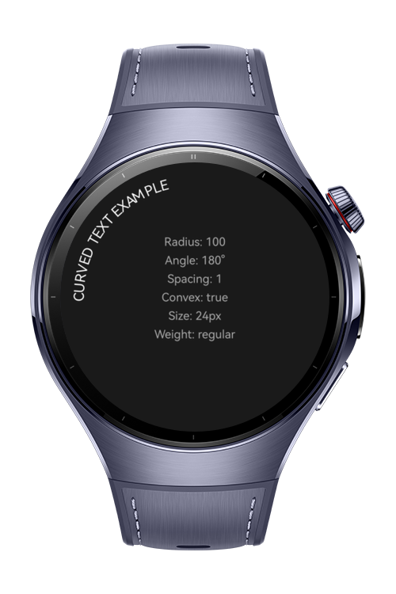
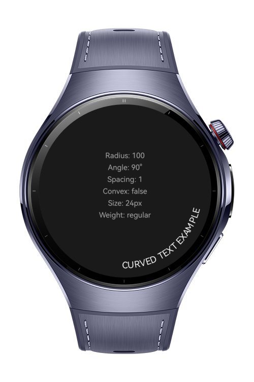
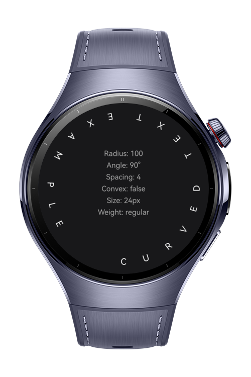
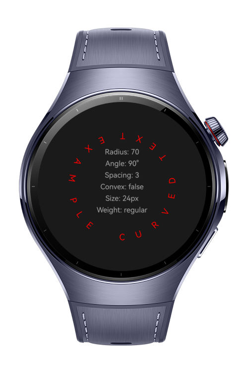

> **Note:** To access all shared projects, get information about environment setup, and view other guides, please visit [Explore-In-HMOS-Wearable Index](https://github.com/Explore-In-HMOS-Wearable/hmos-index).

# How To Create Curved Text

A lightweight and customizable HarmonyOS component designed to render text along a circular path. It handles complex trigonometric calculations and canvas transformations to provide a simple API for curved text effects.

# Preview

<div style="display: flex; justify-content: space-between;">
  
  
  
  
</div>

# Use Cases
- **Watch Face Complications:** Displaying dates or steps around the watch bezel.
- **Dynamic Badges:** Creating circular seals, logos, or emblem-style UI components.
- **Progress Labels:** Placing descriptive text along circular progress bars.
- **UI Decorations:** Enhancing buttons or containers with arched titles.

# Tech Stack
- **Language:** ArkTS (TypeScript-based)
- **Framework:** ArkUI
- **Engine:** Canvas Rendering API (RenderingContext2D)
- **Tooling:** DevEco Studio NEXT

# Directory Structure
```text
/entry/src/main/ets/
└── pages/
    └── Index.ets            <-- Component & Implementation
```

# Technology

## Stack
- **ArkTS:** The primary language for building high-performance HarmonyOS apps.
- **Canvas API:** Used for low-level drawing, allowing precise control over every character.
- **Trigonometry:** Utilizes `Math.cos()` and `Math.sin()` for mapping characters to circular coordinates.

## Required Permissions
No special permissions required.

## Diagrams - Process
1. **Initialize:** Define the starting orientation using `startAngle` and circle scale with `radius`.
2. **Measure:** Get each character's physical width using `measureText` for precise spacing.
3. **Map:** Convert character width into an angular step (`charWidth / radius`) and apply the `spacing` multiplier.
4. **Transform:** `translate` the drawing origin to the calculated (x, y) point on the circle's edge.
5. **Orient:** `rotate` the character to stand perpendicular to the center. Pivot direction depends on `isConvex`.
6. **Dynamic Direction:**
    - **Convex Mode:** Increments the angle to wrap text clockwise.
    - **Concave Mode:** Decrements the angle to wrap text counter-clockwise, ensuring readability.
7. **Iterate:** Repeat the cycle for every character in the string.

# Constraints and Restrictions
## Supported Devices
- Huawei Watch 5

# License (MIT)
Curved Text Component is distributed under the terms of the MIT License.
See the [LICENSE](./LICENSE) for more information.
